# ⚡ FLEXY — Multi-Operator Point-of-Sale & Telecommunication Management System

> **Enterprise-Grade Multi-SIM GSM Automation, Decentralized Licensing, and Point-of-Sale (POS) Ecosystem for Algerian Telecom Operators (Djezzy, Mobilis, Ooredoo).**

[](flexy_flutter)
[](flexy-license-server)
[](Flexy-dashboard)
[](https://firebase.google.com/)
[](flexy-license-server)
[](https://flexy-license.web.app)

---

### 🌐 Live Production Deployments
| Component | Hosting / Infrastructure | Live URL |
| :--- | :--- | :--- |
| **Admin Web Dashboard** | Google Firebase Hosting | 🔗 **[https://flexy-license.web.app](https://flexy-license.web.app)** *(Mirror: [flexy-license.firebaseapp.com](https://flexy-license.firebaseapp.com))* |
| **Licensing & Sync API** | Render Cloud (Docker) | 🔗 **[https://flexy-api-efsc.onrender.com](https://flexy-api-efsc.onrender.com)** |
| **Interactive Swagger Docs** | OpenAPI 3.0 on Render | 🔗 **[https://flexy-api-efsc.onrender.com/api/docs](https://flexy-api-efsc.onrender.com/api/docs)** |
| **Server Health Check** | Render Live Probe | 🔗 **[https://flexy-api-efsc.onrender.com/health](https://flexy-api-efsc.onrender.com/health)** |

---

## 📑 Table of Contents
- [Architecture Overview](#-architecture-overview)
- [System Components](#-system-components)
- [Visual Showcase & Feature Tour](#-visual-showcase--feature-tour)
  - [1. Point of Sale & Recharge Workspace](#1-point-of-sale--recharge-workspace)
  - [2. Customer Credit & Debt Management (Clients & Dettes)](#2-customer-credit--debt-management-clients--dettes)
  - [3. Multi-SIM & License Activation](#3-multi-sim--license-activation)
  - [4. Cloud License Sync & Real-Time Telemetry](#4-cloud-license-sync--real-time-telemetry)
  - [5. AT Modem Terminal & Hardware Diagnostics](#5-at-modem-terminal--hardware-diagnostics)
  - [6. Modem & USSD Hardware Settings](#6-modem--ussd-hardware-settings)
  - [7. User Management](#7-user-management)
  - [8. User Creation Modal](#8-user-creation-modal)
  - [9. Granular RBAC Permissions Matrix](#9-granular-rbac-permissions-matrix)
  - [10. Security Audit Trail & Immutable Logs](#10-security-audit-trail--immutable-logs)
  - [11. Instant Account Switcher](#11-instant-account-switcher)
  - [12. Account Switching Password Verification](#12-account-switching-password-verification)
  - [13. Quick Account Registration](#13-quick-account-registration)
  - [14. Trilingual Localization & Dark/Light Themes](#14-trilingual-localization--darklight-themes)
  - [15. User Profile & Quick Actions](#15-user-profile--quick-actions)
- [Hardware & GSM Modem Compatibility](#-hardware--gsm-modem-compatibility)
- [Project Structure](#-project-structure)
- [How to Run Each Component](#-how-to-run-each-component)
  - [1. Flutter Desktop Application](#1-flutter-desktop-application-flexy_flutter)
  - [2. NestJS Licensing API Server](#2-nestjs-licensing-api-server-flexy-license-server)
  - [3. Vue 3 Admin Dashboard](#3-vue-3-admin-dashboard-flexy-dashboard)
- [Cryptographic Security & Licensing Engine](#-cryptographic-security--licensing-engine)
- [License & Authors](#-license--authors)

---

## 🏛 Architecture Overview

FLEXY is structured as a robust 3-tier decentralized client-server architecture:

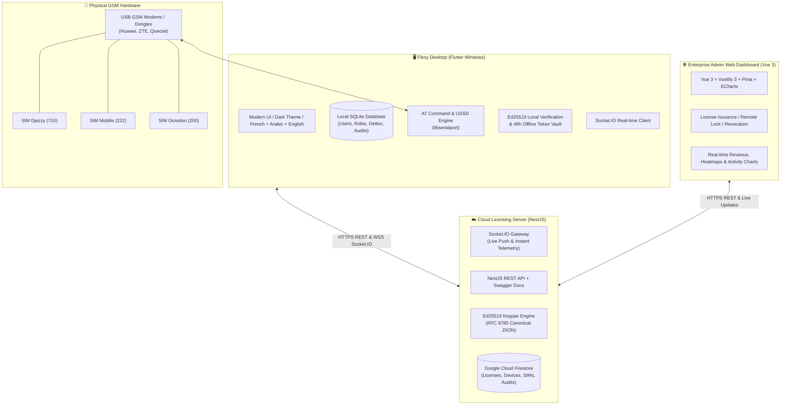

---

## 📦 System Components

1. **`flexy_flutter`** — Modern, high-performance desktop application for Windows point-of-sale terminals. Directly controls physical GSM modems via serial ports (`flutter_libserialport`), executes USSD flexy recharges, tracks customer debts, and enforces role-based access control (RBAC).
2. **`flexy-license-server`** — Enterprise NestJS backend deployed in the cloud. Manages Ed25519 cryptographic license generation, device hardware bindings (UUID + Fingerprint), SIM ICCID SHA-256 verification, and real-time Socket.IO synchronization.
3. **`Flexy-dashboard`** — Vue 3 + Vuetify 3 web dashboard for system administrators. Enables live remote monitoring of connected point-of-sale devices, instant license creation, SIM status tracking, and revenue analytics. Live at **[https://flexy-license.web.app](https://flexy-license.web.app)**.

---

## 📸 Visual Showcase & Feature Tour

All screenshots below represent the production Flutter application interface:

### 1. Point of Sale & Recharge Workspace
*Comprehensive point-of-sale screen with quick-access numeric keypad, customer selection, instant flexy amount presets (100, 200, 500, 1000 DA), real-time SIM connectivity bar across all 3 operators, transaction ledger, and summary metrics.*

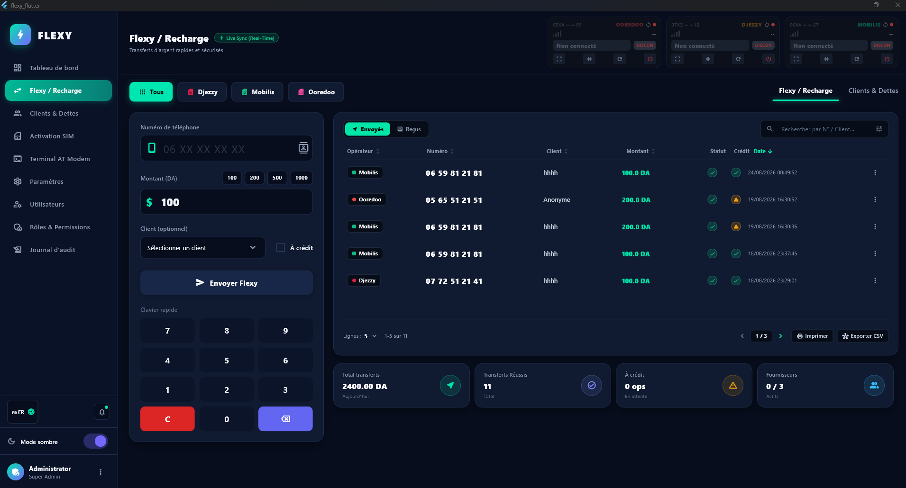

---

### 2. Customer Credit & Debt Management (Clients & Dettes)
*Complete financial ledger for store owners to track deferred payments ("À Crédit"), manage customer balances, record debt repayments, and view comprehensive payment histories.*

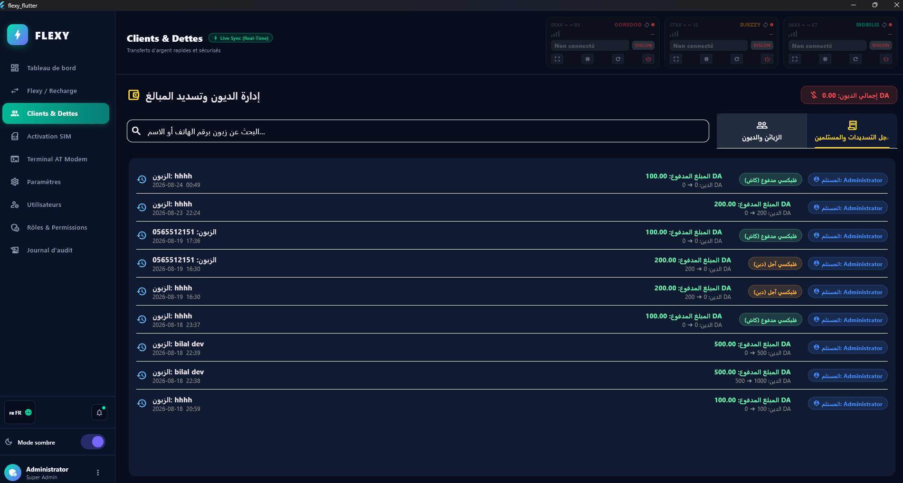

---

### 3. Multi-SIM & License Activation
*License activation interface supporting multiple SIM cards per operator. Automatically extracts the SIM's ICCID via AT commands and validates cryptographic activation serials (`FX1....`).*

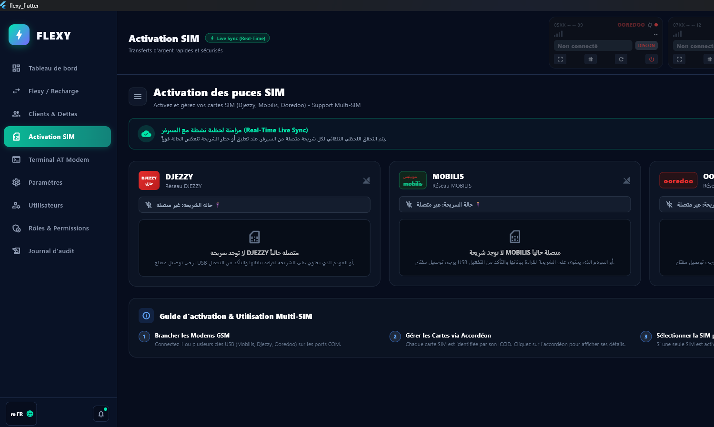

---

### 4. Cloud License Sync & Real-Time Telemetry
*Real-time WebSocket connection badge showing instant synchronization with the cloud license server (`ON-LINE`). Detects remote revocation, expiry, or hardware tampering immediately.*

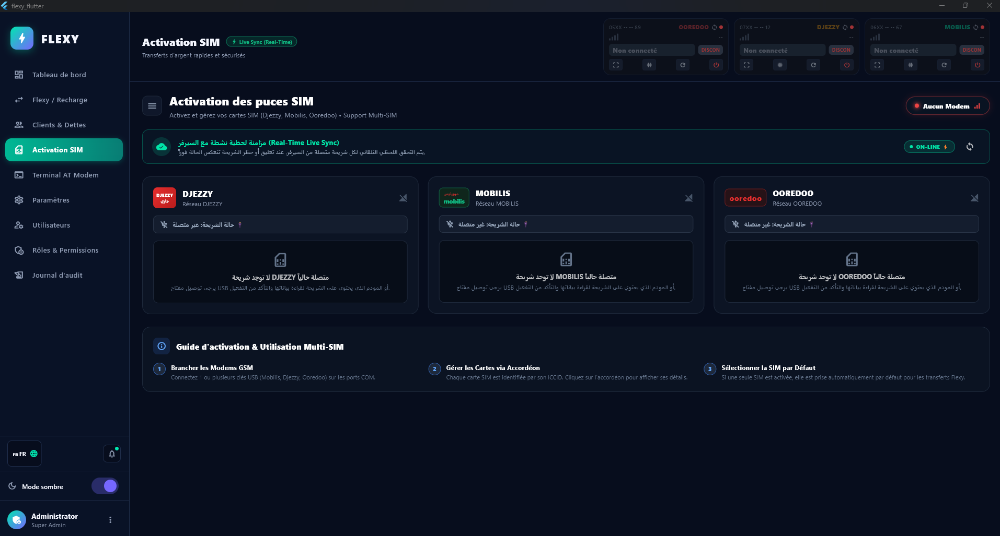

---

### 5. AT Modem Terminal & Hardware Diagnostics
*Integrated low-level serial terminal for technicians. Allows sending raw AT commands (`AT+COPS?`, `AT+CSQ`, `AT+CSCS="GSM"`, USSD strings) with real-time RX/TX monitoring, automatic response decoding, and baud rate selection.*

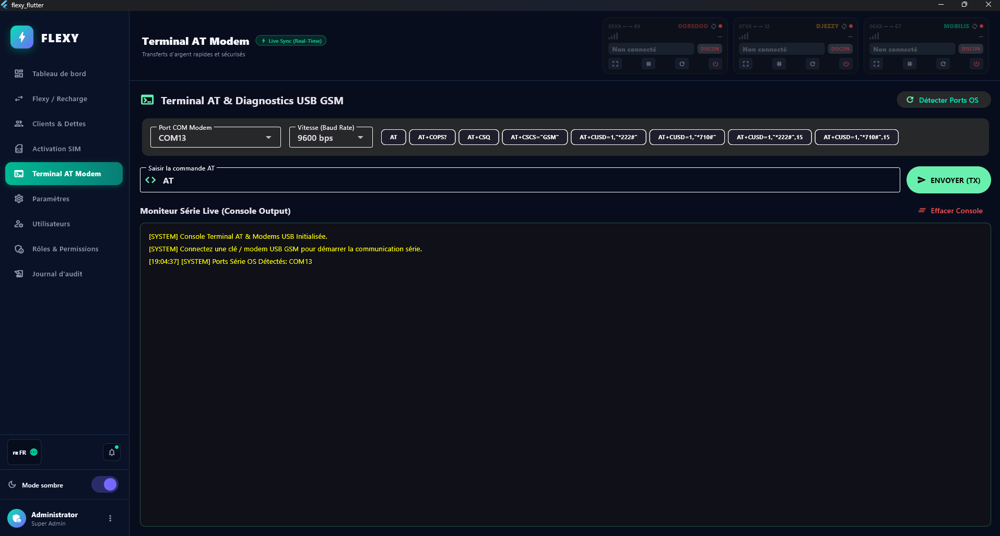

---

### 6. Modem & USSD Hardware Settings
*Hardware configuration panel allowing custom COM port assignment per operator, SIM PIN code management, custom USSD transfer codes, automated USSD dialog confirmation, and Text-To-Speech (TTS) voice announcements.*

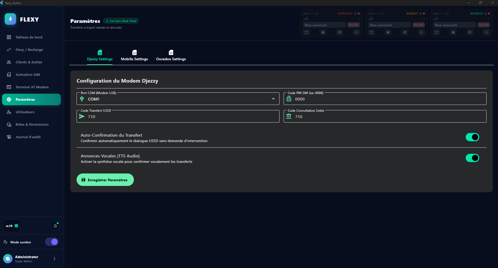

---

### 7. User Management
*Multi-user administration module displaying account status, email, assigned roles, last login timestamps, and account action buttons.*

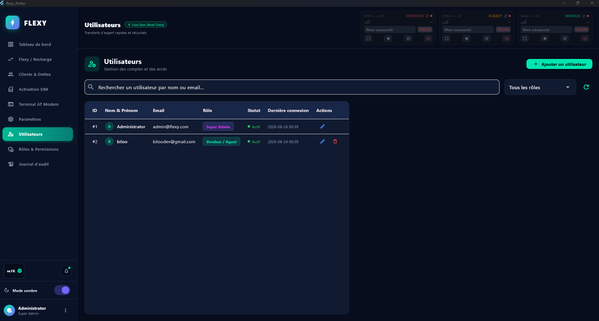

---

### 8. User Creation Modal
*Streamlined dialog for creating new cashier or seller accounts with role-based permission assignment.*

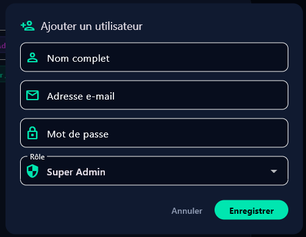

---

### 9. Granular RBAC Permissions Matrix
*Role-Based Access Control matrix defining access levels for Super Admin, Administrator, Manager, Seller/Agent, Cashier, and Accountant across 20+ fine-grained permissions.*

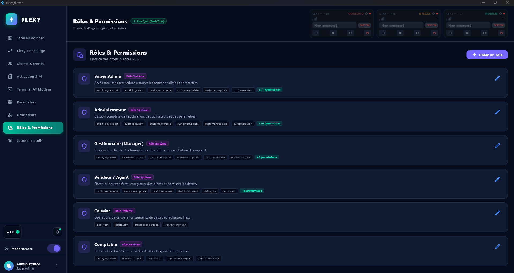

---

### 10. Security Audit Trail & Immutable Logs
*Complete tamper-evident audit log recording every user action, authentication attempt, permission modification, and debt settlement with timestamp and execution status.*

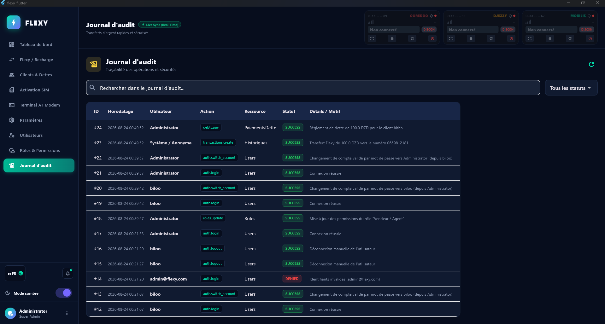

---

### 11. Instant Account Switcher
*Fast account switching modal allowing multiple staff members on the same shift to switch accounts instantly without terminating active processes.*

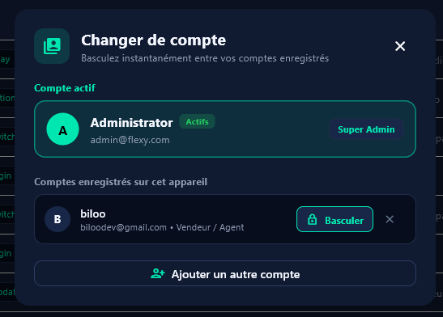

---

### 12. Account Switching Password Verification
*Secure authentication dialog guaranteeing that only authorized staff can unlock and switch into their profile.*

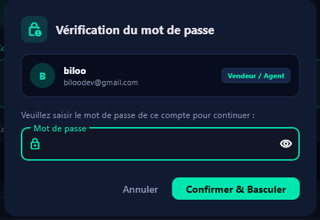

---

### 13. Quick Account Registration
*Inline account onboarding directly from the account switcher.*

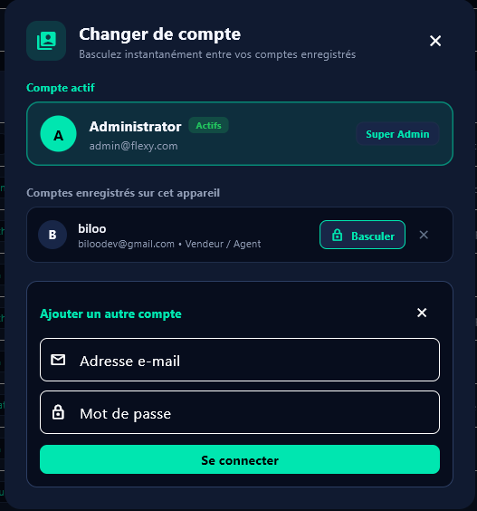

---

### 14. Trilingual Localization & Dark/Light Themes
*Instant UI language switcher supporting French (`FR`), Algerian Arabic (`DZ AR`), and English (`GB EN`), accompanied by dark and light theme modes.*

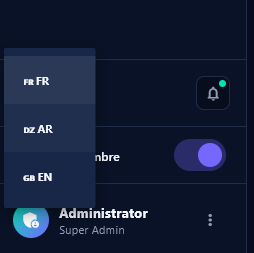

---

### 15. User Profile & Quick Actions
*Quick profile dropdown menu with account switcher shortcut, profile settings, and one-click secure logout.*

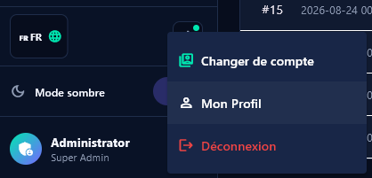

---

## 📶 Hardware & GSM Modem Compatibility

FLEXY is compatible with standard USB GSM Modems and serial COM ports:

| Modem Family | Protocols | Supported Features |
| :--- | :--- | :--- |
| **Huawei E-Series** (E173, E303, E3531, etc.) | AT / USSD / NMEA | Auto-detection, signal strength (`CSQ`), automatic ICCID reading |
| **ZTE MF-Series** (MF190, MF667, MF823, etc.) | AT / NMEA Device | Automatic Diagnostics port exclusion, high-speed baud rates |
| **Quectel / SIMCom Modules** | AT Standard 3GPP | Full USSD prompt handling, SMS notifications |
| **Alcatel & D-Link Dongles** | Standard COM ports | Transfer automation, automated balance query |

---

## 📁 Project Structure

```text
Flexy/
├── images/                         # Screenshot gallery (1.png to 15.png)
├── flexy_flutter/                  # Flutter Windows Desktop Application
│   ├── lib/
│   │   ├── core/                   # Theme, Localization, RBAC Authorization
│   │   ├── database/               # SQLite Database Helper & Migration
│   │   ├── models/                 # Data contracts & DTOs
│   │   ├── providers/              # State management (Provider pattern)
│   │   ├── services/               # Hardware AT Modem, Socket.IO, Audio TTS
│   │   └── views/                  # UI screens & dialogs
│   └── test/                       # Unit & Widget test suite
├── flexy-license-server/        # NestJS Cloud Licensing & Synchronization API
│   ├── src/
│   │   ├── crypto/                 # Ed25519 cryptographic signing & verifier
│   │   ├── database/               # Google Cloud Firestore migrations & seeds
│   │   └── modules/                # Auth, Devices, Modems, SIMs, Licenses, WebSocket
│   └── Dockerfile                  # Containerized deployment
├── Flexy-dashboard/                # Vue 3 Enterprise Web Admin Console
│   └── src/
│       ├── components/             # Reusable Vuetify 3 UI widgets & charts
│       ├── stores/                 # Pinia state stores
│       └── views/                  # Web dashboard screens
└── README.md                       # Master Documentation (this file)
```

---

## 🚀 How to Run Each Component

### 1. Flutter Desktop Application (`flexy_flutter`)
> Detailed guide: [flexy_flutter/README.md](flexy_flutter/README.md)

```powershell
# Navigate to the Flutter workspace
cd "flexy_flutter"

# Install Flutter dependencies
flutter pub get

# Run in Development Mode with Hot Reload
flutter run -d windows

# Build Production Release
flutter build windows --release

# Run Production Executable
& ".\build\windows\x64\runner\Release\flexy_flutter.exe"
```

---

### 2. NestJS Licensing API Server (`flexy-license-server`)
> Detailed guide: [flexy-license-server/README.md](flexy-license-server/README.md)

```powershell
# Navigate to the backend directory
cd "flexy-license-server"

# Install dependencies
npm install

# Run database migrations and operator seeds
npm run cli migrate
npm run cli seed:operators

# Start the development server
npm run start:dev

# Live Swagger documentation:
# http://localhost:10000/api/docs
```

---

### 3. Vue 3 Admin Dashboard (`Flexy-dashboard`)
> Detailed guide: [Flexy-dashboard/README.md](Flexy-dashboard/README.md)

```powershell
# Navigate to the dashboard directory
cd "Flexy-dashboard"

# Install web dependencies
npm install

# Start Vite development server
npm run dev

# Build for Production
npm run build
```

**🌐 Live Hosted Dashboard:**
- Production URL: **[https://flexy-license.web.app](https://flexy-license.web.app)**
- Firebase Mirror: **[https://flexy-license.firebaseapp.com](https://flexy-license.firebaseapp.com)**

---

## 🔐 Cryptographic Security & Licensing Engine

1. **Zero-Trust Client Model**:
   - The desktop client is never treated as a source of truth. All license activations verify hardware fingerprints, machine UUIDs, modem IMEIs, and SHA-256 hashed ICCIDs against the cloud database.
2. **Ed25519 Asymmetric Digital Signatures**:
   - Licenses are formatted as `FX1.<canonical_base64_payload>.<signature_base64>`.
   - Verified offline by the client and validated live via WebSocket connection.
3. **48-Hour Offline Grace Period**:
   - Stores with intermittent internet access receive signed offline tokens allowing continuous operations up to 48 hours without compromising anti-piracy integrity.
4. **Binary Protection**:
   - Flutter Desktop compiles into Ahead-Of-Time (AOT) machine code binary (`x64 Assembly`), preventing source-code reverse engineering.

---

## 📄 License & Authors

Designed and engineered for point-of-sale telecommunication operations in Algeria.  
All rights reserved © 2026.
